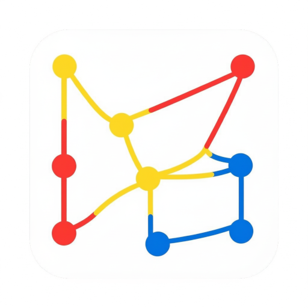

<div align="center">
  

  <h1>StimmApp</h1>
  <p><strong>Ideen einbringen. Meinungen sichtbar machen. Gemeinsam mitgestalten.</strong></p>
  <p>Eine App für Petitionen, Abstimmungen und Umfragen – mit dem Ziel,<br>politische Beteiligung auf Bundes- und Landesebene einfacher zugänglich zu machen.</p>

  <p>
    
    
    
    
    <a href="LICENSE"></a>
  </p>

  <p>
    <a href="#funktionen">Funktionen</a> ·
    <a href="#lokaler-einstieg">Lokaler Einstieg</a> ·
    <a href="#entwicklung">Entwicklung</a> ·
    <a href="#website">Website</a> ·
    <a href="#dokumentation">Dokumentation</a>
  </p>
</div>

---

## Die Idee

StimmApp verbindet Menschen, die etwas bewegen möchten: Anliegen als Petition veröffentlichen, Meinungen mit Umfragen einholen und sich in Gruppen organisieren. Langfristig soll daraus eine Plattform für breitere demokratische Beteiligung entstehen.

> **Projektstatus:** StimmApp befindet sich in Entwicklung. Die Vision umfasst perspektivisch auch Volksentscheide und Wahlen; diese gehören zu den langfristigen Zielen.

## Funktionen

| | Bereich | Möglichkeiten |
| :---: | --- | --- |
| ✍️ | **Petitionen** | Petitionen erstellen, entdecken und unterzeichnen |
| 🗳️ | **Abstimmungen & Umfragen** | Einzelne Auswahlfragen sowie Fragebögen mit mehreren Fragen und Texteingaben erstellen und beantworten |
| 👥 | **Gruppen** | Inhalte gemeinsam organisieren und Mitglieder verwalten |
| 🧩 | **Vorlagen & Import** | Formulare wiederverwenden und Petitionen oder Abstimmungen per JSON importieren |
| 🔎 | **Entdecken** | Petitionen und Umfragen mithilfe von Filtern finden |
| 👤 | **Profil & Anmeldung** | Ein Benutzerkonto anlegen, die E-Mail-Adresse bestätigen und das eigene Profil verwalten |

### Langfristige Ziele

- **Eindeutige Identitätsprüfung**, etwa über BundID oder eID, für verlässlichere Beteiligung.
- **Volksentscheide und Wahlen** als weitere Beteiligungsformate.
- **Organisationen und Kanälen folgen**, um über deren Anliegen informiert zu bleiben.

## Lokaler Einstieg

### Voraussetzungen

- **Flutter** in der Version aus [`.flutter-version`](.flutter-version), einschließlich Dart.
- Eine passende Entwicklungsumgebung für Android oder iOS; für iOS zusätzlich **macOS und Xcode 27.0**.
- Zugriff auf das Firebase-Entwicklungsprojekt und die benötigte lokale Konfiguration.
- **Node.js 22 und npm**, wenn du an Cloud Functions oder der Website arbeitest.

### App einrichten und starten

Führe die folgenden Befehle im Stammverzeichnis des Repositories aus:

```bash
# Flutter-Abhängigkeiten anhand der eingecheckten Sperrdatei installieren
flutter pub get --enforce-lockfile

# Lokale Konfiguration anlegen, sofern noch keine .env vorhanden ist
cp -n .env.example .env
```

Trage die für deine Umgebung benötigten Werte in `.env` ein. Die Datei ist von Git ausgeschlossen; die verfügbaren Konfigurationsfelder findest du in [`.env.example`](.env.example).

```bash
# Entwicklungsvariante auf einem verbundenen Gerät oder Emulator starten
flutter run --flavor dev -t lib/main_dev.dart --dart-define-from-file=.env
```

Die App nutzt Firebase-Dienste. Für die entsprechenden Funktionen benötigst du neben der lokalen Konfiguration auch Zugriff auf die eingerichteten Backend-Dienste.

### Umgebungen

| Umgebung | Flutter-Flavor | Einstiegspunkt | Firebase-Projekt | CLI-Alias |
| --- | --- | --- | --- | --- |
| Entwicklung | `dev` | `lib/main_dev.dart` | `stimmapp-dev` | `dev` |
| Produktion | `prod` | `lib/main.dart` | `stimmapp-f0141` | `prod` |

## Entwicklung

### Aufbau des Repositories

```text
lib/
├── app/                  Seiten, Widgets und Layouts
├── core/
│   ├── config/           Initialisierung und Umgebungskonfiguration
│   ├── data/             Modelle, Repositories und Dienste
│   └── providers/        Riverpod-Zustandsverwaltung
├── main_dev.dart         Einstiegspunkt für die Entwicklung
└── main.dart             Einstiegspunkt für die Produktion
functions/                Firebase Cloud Functions in TypeScript
website/                  Website mit Next.js und statischem Export
test/                     Automatisierte Tests
integration_test/         Integrationstests
docs/developer/           Technische Anleitungen
```

Das Backend verwendet Firebase Authentication, Cloud Firestore, Cloud Storage und Cloud Functions. Gemeinsamer App- und Fachzustand wird schrittweise auf **Riverpod** umgestellt.

### Code prüfen

```bash
flutter analyze
flutter test
```

<details>
<summary><strong>Cloud Functions entwickeln und bereitstellen</strong></summary>

Die Cloud Functions verwenden TypeScript und die Node.js-22-Laufzeit. Installiere und kompiliere sie aus dem Projektstamm mit:

```bash
npm --prefix functions ci
npm --prefix functions run build
```

Für die Bereitstellung benötigst du die Firebase CLI und Zugriff auf das Zielprojekt. Wähle das Projekt ausdrücklich aus, beispielsweise die Entwicklungsumgebung:

```bash
firebase deploy --only functions --project dev
```

SMTP-Zugangsdaten werden über Google Cloud Secret Manager verwaltet und müssen für das jeweilige Firebase-Projekt eingerichtet sein.

</details>

<details>
<summary><strong>Android- und iOS-Release-Builds</strong></summary>

Android-App-Bundle für StimmApp in der Produktionsumgebung:

```bash
flutter build appbundle --release --flavor prod -t lib/main.dart --dart-define-from-file=.env
```

Für iOS nutzt das Projekt den von Flutter verwalteten **Swift Package Manager**. Die Einrichtung erfolgt ohne `pod install`. Simulator-, Archiv- und Signierungsanleitungen stehen in der [iOS-Build-Dokumentation](docs/developer/ios-builds.md).

</details>

## Website

Die Website liegt unter [`website/`](website/) und verwendet Next.js mit statischem Export.

```bash
cd website
npm ci
npm run dev
```

Für einen veröffentlichbaren Build:

```bash
npm run build
```

Die erzeugten Dateien liegen anschließend in `website/out/`, bezogen auf den Projektstamm.

Im Repository sind zwei GitHub-Actions-Workflows für die Veröffentlichung hinterlegt:

| Workflow | Aufgabe |
| --- | --- |
| [`deploy-pages.yml`](.github/workflows/deploy-pages.yml) | Statischen Export über GitHub Pages dieses Repositories veröffentlichen |
| [`publish-website-repos.yml`](.github/workflows/publish-website-repos.yml) | Gemeinsamen Website-Build an die separaten Deployment-Repositories für `stimmapp.net` und `vivot.net` übertragen |

Beide Workflows reagieren auf relevante Änderungen im Branch `main` und lassen sich manuell starten. Die Einrichtung der separaten Repositories und der Domains beschreibt die [Anleitung zur Website-Veröffentlichung](docs/developer/website-deploy-repos.md).

## Dokumentation

| Thema | Anleitung |
| --- | --- |
| Architektur und Konventionen | [Entwicklerhandbuch](AGENTS.md) |
| iOS, Swift Package Manager und Signierung | [iOS-Builds](docs/developer/ios-builds.md) |
| Firebase-Umstellung auf Swift Package Manager | [Migrationscheckliste](docs/developer/firebase-spm-migration.md) |
| Formularimport | [JSON-Format und Beispiele](docs/developer/form-json-import.md) |
| Google-Anmeldung | [Einrichtung von Google Sign-In](docs/developer/google-sign-in.md) |
| Website und Deployment-Repositories | [Website-Veröffentlichung](docs/developer/website-deploy-repos.md) |

## Mitwirken

Fehlerberichte, Verbesserungsvorschläge und Beiträge sind willkommen. Beschreibe bei Fehlern möglichst die Schritte zur Reproduktion, das erwartete Verhalten und die verwendete Plattform. Orientiere dich bei Änderungen am [Entwicklerhandbuch](AGENTS.md) und prüfe den betroffenen Code mit Analyzer und passenden Tests.

## Lizenz

Dieses Projekt steht unter der **GNU General Public License v3.0**. Den vollständigen Lizenztext findest du in [`LICENSE`](LICENSE).
